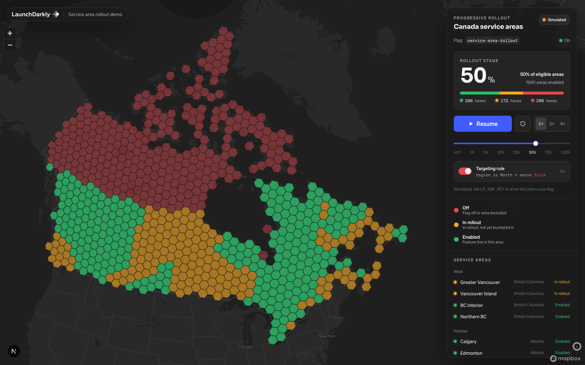

# Service Area Rollout · Canada

A LaunchDarkly demo: a Mapbox map of Canada tiled with fixed-size hexes, grouped into 41 named
service areas. A boolean flag under a **progressive rollout** lights the areas up red → yellow → green.



| Colour | Meaning |
|---|---|
| 🔴 Red | Flag off for this area, or the area is explicitly excluded by a rule |
| 🟡 Yellow | Rollout is active but this area hasn't been bucketed into the new variation yet |
| 🟢 Green | Feature enabled for this area |

It runs in two modes:

- **Live** — when `LD_SDK_KEY` is set, the server evaluates the flag for every service area with the
  LaunchDarkly Node SDK and the map polls every 2 s. Anything you do in the LaunchDarkly UI shows up
  on the map: progressive rollouts, targeting rules, kill switch.
- **Simulated** — when no SDK key is set, a built-in deterministic rollout engine drives the same UI.
  Press **Play** to step through `off → 1% → 5% → 10% → 25% → 50% → 75% → 100%`. A simulated
  targeting rule `region is North → false` keeps Yukon, NWT and Nunavut red for the whole rollout;
  flip the **Targeting rule** switch in the panel to include them.

## Quick start

```bash
pnpm install
cp .env.example .env.local      # add your Mapbox token (and optionally an LD SDK key)
pnpm dev                        # http://localhost:3000
```

### Environment variables

| Variable | Required | Notes |
|---|---|---|
| `NEXT_PUBLIC_MAPBOX_TOKEN` | Yes | Public token (`pk.…`) from https://account.mapbox.com/access-tokens/ |
| `LD_SDK_KEY` | No | **Server-side** SDK key (`sdk-…`). Enables live mode. |
| `LD_FLAG_KEY` | No | Defaults to `service-area-rollout` |

## Setting up the LaunchDarkly flag (live mode)

1. In your LaunchDarkly project, create a **boolean** flag with key `service-area-rollout`
   (or set `LD_FLAG_KEY` to whatever you choose). Serve `false` when off.
2. Each service area is evaluated as a context of kind **`service-area`** with these attributes:

   | Attribute | Example values |
   |---|---|
   | `key` | `greater-toronto`, `montreal`, `calgary`, … (see `src/data/service-areas.ts`) |
   | `name` | `Greater Toronto` |
   | `province` | `BC AB SK MB ON QC NB NS PE NL YT NT NU` |
   | `region` | `West` `Prairies` `Central` `Atlantic` `North` |
   | `populationTier` | `metro` `regional` `remote` |

   The context kind appears in LaunchDarkly automatically after the first evaluation, so load the
   page once with the SDK key set before you build targeting rules.
3. Copy the server-side SDK key for the environment into `.env.local` as `LD_SDK_KEY` and restart `pnpm dev`.
   The badge in the panel should read **Live · LaunchDarkly**.

### Demo moves

| In LaunchDarkly | On the map |
|---|---|
| Flag **off** | Everything red |
| Flag **on**, default rule → **progressive rollout** to `true` | All areas go yellow, then turn green stage by stage as the rollout advances |
| Add rule `province is QC` → `true` | Every Québec area turns green immediately, regardless of rollout % |
| Add rule `populationTier is metro` → `true` | Vancouver, Calgary, Edmonton, Winnipeg, Toronto, Ottawa, Montréal, Québec City, Halifax light up first (classic "metros first" story) |
| Add rule `region is North` → `false` | Yukon, NWT and Nunavut go red (explicitly excluded) while the rest keep rolling out |
| Toggle flag off mid-rollout | Instant kill switch: all red within ~2 s |

The evaluation reason is mapped to colour in `src/lib/rollout/ld.ts`:
`value === true` → green; `FALLTHROUGH` + `false` → yellow (in the rollout, not bucketed yet);
`OFF`, `RULE_MATCH`, `TARGET_MATCH`, `PREREQUISITE_FAILED`, `ERROR` + `false` → red.

> Tip: for a tight stage demo, configure the progressive rollout with short stage durations
> (e.g. 1 minute each) or advance it manually.

## Simulated mode talk track

1. Start at **off** (all red). "This is the feature dark across the country."
2. Press **Play**. At 1 % one area turns green, the eligible areas go yellow, and the three northern
   territories stay red. "LaunchDarkly has started the rollout. The yellow areas are in scope and
   waiting to be bucketed; the red block is excluded by a targeting rule."
3. Watch stages advance. "Buckets are deterministic: an area that's enabled at 25 % stays enabled at 50 %."
4. Flip the **Targeting rule** switch off mid-rollout. "Remove the rule and the North joins the
   rollout instantly, at whatever stage we're on."
5. Use the **scrubber** to jump to any stage, **Reset** for the kill-switch story, **1× 2× 4×** for pacing.
6. Hover any hex (or any row in the list) to highlight the whole service area.

Space bar toggles play/pause.

## Project layout

```
scripts/build-hexes.ts         Generates the hex grid (Natural Earth provinces → H3 res 3 → service areas)
public/data/hexes.json         Pre-built grid (754 hexes). Committed; no network needed at runtime.
src/data/service-areas.ts      The 41 service areas (id, name, province, region, tier, centroid)
src/lib/rollout/types.ts       Status model + colours
src/lib/rollout/simulation.ts  Deterministic progressive-rollout simulation
src/lib/rollout/ld.ts          LaunchDarkly Node SDK evaluation per service area
src/app/api/rollout/route.ts   GET /api/rollout → snapshot (live) or simulation fallback
src/hooks/useRollout.ts        Live polling vs simulation engine + transport controls
src/hooks/useHexData.ts        Loads hexes.json
src/components/HexMap.tsx      Mapbox GL map, locked to Canada, data-driven hex colouring
src/components/ControlPanel.tsx Right-hand glass panel
src/components/Legend.tsx
```

## Customising

- **Hex size** — change `HEX_RESOLUTION` in `scripts/build-hexes.ts` (or `HEX_RESOLUTION=4 pnpm hexes`).
  Resolution 3 ≈ 12,400 km² per hex (754 hexes); resolution 4 ≈ 1,770 km² (~5,500 hexes).
- **Service areas** — edit `src/data/service-areas.ts`, then `pnpm hexes`. Hexes attach to the nearest
  area centroid within the same province, and every area is guaranteed at least one hex.
- **Rollout stages / pacing** — `DEFAULT_STAGES` and `DEFAULT_STAGE_DURATION_MS` in `src/lib/rollout/simulation.ts`.
- **Excluded block** — `EXCLUDED_REGION` in `src/lib/rollout/simulation.ts` (default `North`). Any `Region`
  value works; in live mode, recreate it as a real rule on the flag.
- **Colours** — `STATUS_COLORS` in `src/lib/rollout/types.ts` and the `--status-*` tokens in `src/app/globals.css`.
- **Map style / view** — `CANADA_BOUNDS`, `PANEL_WIDTH`, the projection (Lambert conformal conic) and the
  style URL in `src/components/HexMap.tsx`. The camera fits to the hexes themselves on load and then locks
  min zoom and pan bounds, so the view stays on Canada at any window size.

## Deploying

Standard Next.js app. On Vercel, add the three environment variables to the project and deploy; the
`/api/rollout` route runs on Node.js. The LaunchDarkly client is a per-instance singleton, so cold
starts add ~1 s on the first poll.

## Scripts

| Command | What it does |
|---|---|
| `pnpm dev` | Dev server |
| `pnpm build` / `pnpm start` | Production build / serve |
| `pnpm lint` | ESLint |
| `pnpm hexes` | Regenerate `public/data/hexes.json` |
